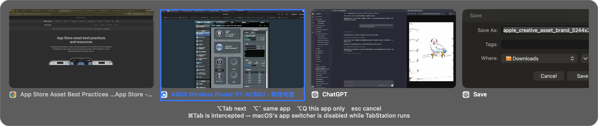

# AltDeck

A native macOS window switcher — the AltTab experience: hold **⌥**, tap **Tab**,
and pick the exact window you want from live thumbnails. Release **⌥** to switch.

Built with Swift + AppKit. No Electron, no runtime dependencies, no network access.



---

## Build and run

```bash
./build-app.sh            # release build → dist/AltDeck.app
./build-app.sh debug      # faster build, slower at runtime
open dist/AltDeck.app
```

Build artefacts go to `~/.cache/altdeck-build`, not into the project. On a
file-synced Desktop, building in-tree makes every SDK stat-cache read a network
round trip — the same clean build measured 12+ minutes in-tree versus 24s
out-of-tree.

The script compiles with SwiftPM, wraps the binary in a proper `.app` bundle, and
ad-hoc signs it. Installing to `~/Applications` is recommended:

```bash
cp -R dist/AltDeck.app ~/Applications/
open ~/Applications/AltDeck.app
```

> **Don't run it from a file-synced Desktop.** macOS keeps re-applying
> `com.apple.FinderInfo` to a freshly created `.app` under Desktop/iCloud sync,
> which `codesign --verify` rejects and which makes the bundle disappear from
> Finder listings. `build-app.sh` signs in a scratch directory to dodge this,
> but anything living in a synced folder can still get re-tagged.
> `~/Applications` is local and unaffected.

> **Note on signing:** AltDeck is ad-hoc signed. macOS ties Accessibility and
> Screen Recording grants to a bundle's identity, so if you rebuild after granting
> permissions, use **Relaunch AltDeck** from the menu bar icon (or re-grant) —
> a stale grant silently degrades the app to icon mode.

## Permissions

AltDeck asks for two permissions. Both are optional in the sense that the app
stays usable without them, but one of them is required for the core gesture:

| Permission | Why | Without it |
|---|---|---|
| **Accessibility** | Observes the ⌥-hold gesture via a `CGEventTap`, and raises a *specific* window rather than just its app | **⌥Tab does nothing.** The app tells you what's missing |
| **Screen Recording** | Reads window titles and captures thumbnails | Falls back to large app icons, labelled "App — Window N" |

Grant them in **System Settings → Privacy & Security**, or click through from the
menu bar icon (it shows live on/off status and links straight to each pane).

## Controls

Hold **⌥** (or your configured trigger modifier) throughout.

| Key | Action |
|---|---|
| **⌥Tab** | Next window (opens the switcher, selecting the most recently used window) |
| **⌥⇧Tab** | Previous window (opens on the oldest) |
| **→ / ↓** | Navigate to the next window |
| **← / ↑** | Navigate to the previous window |
| **⌥`** | Cycle within the *same app* as the current selection |
| **⌥Q** | Filter to the current app's windows only; press again to toggle back |
| **W** or **⌫** | Close the currently selected window |
| **M** | Minimize the currently selected window |
| **⌘Q** | Quit the selected application |
| **Trackpad swipe / Mouse wheel** | Smoothly scroll horizontally through the window strip |
| **Hover close button (×)** | Click the top-right button on any thumbnail to close that window |
| **esc** | Cancel — close without switching |
| Release **⌥** | Switch to the selected window (unminimizes if minimized) |
| Click | Switch to that window |

**⌘Tab is left alone.** The event tap only intercepts chords whose modifier set
matches yours exactly, so the system app switcher keeps working as normal.

### Taking over ⌘Tab

**Menu bar → Override ⌘Tab**, or the checkbox in Preferences. Off by default.

⌘Tab is owned by the WindowServer, so AltDeck normally can't see it. With the
override on, the event tap *swallows* ⌘Tab (the callback returns `nil`), which
prevents the system app switcher from ever acting on it — then drives the
switcher from the same chord: hold ⌘, tap Tab to cycle, release ⌘ to commit.

What this costs you:

- **⌘Tab stops working in every application**, not just the focused one. Quit
  AltDeck and it comes back.
- It's undocumented behaviour. A future macOS update could stop it working.
- It's the one part of this app I could not verify in my test environment (no
  Accessibility permission available to a headless shell), so treat it as
  experimental until you've confirmed it behaves on your machine.

The switcher displays a standing notice while the override is active so the
trade-off is never invisible.

### Changing the shortcuts

**Menu bar icon → Preferences…** (`⌘,`). Three independent chords, like AltTab's
Controls tab — click a field, press the combination you want, and it applies
immediately, no relaunch:

| Field | Default | Does |
|---|---|---|
| Switch windows | ⌥Tab | Next window (⇧ added = previous) |
| Switch windows of the same app | ⌥` | Next window of the same app (⇧ = previous) |
| Show only windows of the current app | ⌥Q | Filter to the current app; press again to toggle back |

The switcher's own footer legend always shows your actual bindings. Collisions
are refused with an explanation (e.g. "Same as … — pick something different"),
as are system-owned chords: `⌘Tab` unless the override below is on, ``⌘` ``
always, and `esc` always.

## How it works

```
HotKeyInterceptor ──(CGEventTap)──▶ SwitcherController ──▶ SwitcherView / SwitcherPanel
                                           │
                          WindowEnumerator  │  ThumbnailService
                           (window list)     │  (ScreenCaptureKit)
                                           ▼
                                    WindowActivator (AXUIElement)
```

A few decisions worth knowing about:

**Window list — `CGWindowListCopyWindowInfo`.** Reads geometry, owner and PID with
*no* permissions at all; only window *names* get redacted without Screen Recording.
That is what lets the switcher keep working in degraded icon mode. Windows are
filtered to layer 0, visible, non-transparent, and owned by apps with a `.regular`
activation policy — which drops tooltips, the Dock, and background agents. Results
are grouped by app in front-to-back order, which is what makes ⌥` ("cycle within
this app") a natural two-key gesture.

**Thumbnails — ScreenCaptureKit, not CoreGraphics.** `CGWindowListCreateImage` is
annotated `SCREEN_CAPTURE_OBSOLETE` as of macOS 15 in the SDK, so AltDeck uses
`SCContentFilter(desktopIndependentWindow:)` + `SCScreenshotManager.captureImage`.
The important property: it renders a window's own content **even when that window is
completely covered**, which is the entire point of a switcher. Captures run at up to
4 concurrently, sized to the exact on-screen cell (2x for Retina) so nothing is
resampled, and are discarded if the switcher closes before they land.

**Raising a window — `AXUIElement`.** `NSRunningApplication.activate()` alone lands
on whichever window the app considers "main", which is wrong the moment an app has
several open. AltDeck matches the CoreGraphics window ID against the AX window
list and raises that element. This needs the undocumented-but-long-stable
`AXWindowNumber` attribute, which has no symbol in the SDK — hence the literal
string in `WindowActivator.swift`. Without Accessibility it degrades to a plain
app activation.

**Scrolling.** The strip is moved inside a clipping container by changing the
*view's* frame, never with `sublayerTransform`. A layer-only transform looks
identical but is invisible to `NSView.hitTest`, so clicks would silently land on
the wrong thumbnail as soon as the list scrolled.

**The panel** is a borderless, non-activating `NSPanel` at `popUpMenu` level: it
floats over full-screen apps, follows you across Spaces, and never takes keyboard
focus, so the app behind it keeps its ⌥-chord.

## Project layout

```
Sources/AltDeck/
  main.swift              entry point (LSUIElement / accessory agent)
  AppDelegate.swift       status item, permissions, onboarding
  Shortcut.swift          keycode table, shortcut model, validation, storage
  ShortcutRecorderView.swift  click-to-record field
  PreferencesWindowController.swift  the Preferences window
  HotKeyInterceptor.swift CGEventTap; chord → SwitcherKey
  SwitcherController.swift presentation, selection, commit/cancel
  SwitcherView.swift      strip layout, scrolling, footer
  SwitcherPanel.swift     borderless non-activating panel
  WindowItemView.swift    one thumbnail cell
  WindowEnumerator.swift  window list + filtering
  ThumbnailService.swift  ScreenCaptureKit capture (actor)
  WindowActivator.swift   AXUIElement raise / activate
  WindowInfo.swift        window model
  Theme.swift             colours, metrics, motion
Tools/                    dev helpers (see below)
build-app.sh              build → bundle → sign
```

### Dev tools

Not part of the app bundle:

```bash
swift Tools/GenerateIcon.swift out.iconset   # renders AppIcon.icns (CoreGraphics only)
swift Tools/ProbeCapture.swift               # exercises the SCK capture path
swift Tools/HoldOptionTab.swift 2.0          # posts a synthetic ⌥-hold-Tab chord
```

## Current limitations

- The trigger is configurable, but ``⌘` `` is always blocked (cycle-windows belongs to macOS).
- Verified on macOS 27.2 (arm64); `Package.swift` declares a macOS 14 minimum.